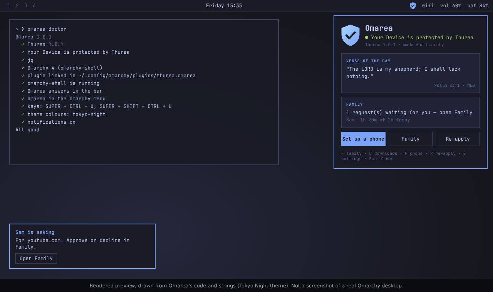
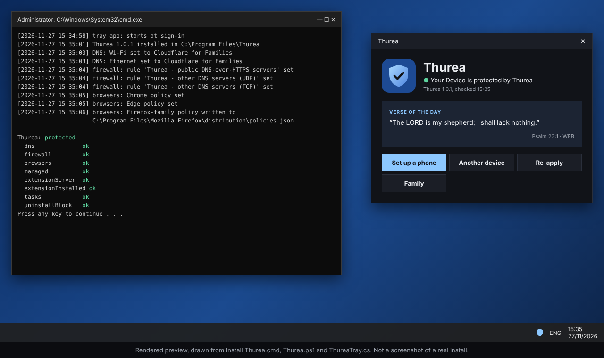

# Thurea

The name comes from the Ancient Greek *thureos* (θυρεός), a large door-shaped shield that covered
the whole body. It's the word behind "the shield of faith" in Ephesians 6:16.

Family protection that blocks ads, trackers and adult sites on every device in the house, and is
hard to switch off.

## Install

Get the files from the [latest release](https://github.com/ShaddickDev/thurea/releases/latest).
Thurea updates itself and can't be removed once installed: that's the point. Both kinds of install
use the same files; a family is something you add afterwards.

### Single adult

Protect your own devices. No family, no parent or child roles.

```sh
# Arch / Omarchy
curl -LO https://github.com/ShaddickDev/thurea/releases/latest/download/thurea-linux.pkg.tar.zst
sudo pacman -U thurea-linux.pkg.tar.zst
omarea doctor      # on Omarchy: check that Omarea is fitted in

# Debian / Ubuntu
curl -LO https://github.com/ShaddickDev/thurea/releases/latest/download/thurea-linux.deb
sudo apt install ./thurea-linux.deb

# Fedora
sudo dnf install https://github.com/ShaddickDev/thurea/releases/latest/download/thurea-linux.rpm
```

* **Windows 10 / 11:** double-click `thurea-windows.msix` → *Install* → *Launch*. (Or extract
  `thurea-windows.zip` and right-click `Thurea\Install Thurea.cmd` → *Run as administrator*.)
* **Your phone:** on a computer with Thurea, open **Keep my phone** (nothing erased) or
  **Set up a phone** (new phone) and scan the code.
* **Browser extension:** nothing to do. Every desktop install puts it in every Chrome-family and
  Firefox-family browser.

### Family

Parents manage their children's devices. Install as above on every device, parents' included, then:

1. `sudo thurea init` on the first computer, `sudo thurea join CODE` on the rest.
2. **Family** → *Start a family* on a parent's device.
3. Set up each child's phone with **Set up a phone**, then mark it *A child's device*.

Every option and the full family setup: [docs/install.md](docs/install.md).

## What it does

* Family DNS on Linux and Android, with other DNS and DNS-over-HTTPS blocked, and 64,000+ blocked
  domains on Linux. Windows leaves DNS alone and filters in the browser.
* Browsers locked down: the Thurea extension (ads, trackers, YouTube ads, SponsorBlock, video
  downloads), SafeSearch, no incognito.
* Parents decide, children ask: approvals, screen time, bedtime and Lock now, from a phone or the
  Family window.
* One app on every desktop (Omarea on Omarchy, a tray elsewhere) with status, a verse of the day
  and phone setup.

| Omarchy (Omarea) | Windows install |
|---|---|
|  |  |

*Rendered previews drawn from the code, not screenshots of real machines.*

## More

| | |
|---|---|
| [Install in detail](docs/install.md) | Every platform, Omarea commands, family setup |
| [What each platform does](docs/platforms.md) | Windows, Linux, Android, the extension |
| [Parents and children](docs/parents-and-children.md) | Rules, screen time, children's accounts, your own relay |
| [Family control centre](docs/family.md) | The parents' window on every device |
| [Desktop apps](docs/desktop-apps.md) | Omarea, the Linux tray, the Windows tray |
| [Omarea](docs/omarea.md) | Thurea made for Omarchy |
| [Windows](docs/windows.md) | How it protects, games and anti-cheat, recovery |
| [Releasing](docs/releasing.md) | Updates, push to release, building, repository layout |
| [Credits](CREDITS.md) | Everything Thurea ships and its licences |

## Licence

Thurea is free and open source under the [MIT License](LICENSE). Copyright © 2026 Luke Shaddick (ShaddickDev).
Third-party parts keep their own licences: see [Credits](CREDITS.md).
